## Описание задания

П01. Базовое администрирование Linux.
Управление пользователями. Вход SSH по ключу
1. Установить VirtualBox или аналог
2. Создать vm (сеть в режиме Nat, пробросить порт 22 из хостовой системы в VM)
3. Установить Ubuntu 24.04
4. Обновить ОС (опционально), установить и запустить SSH сервер
5. Провести диагностику – uname, lsb_release, top, ls, lsblk, fdisk, mount, chown, chmod
6. Продиагностировать сеть – ip addr, traceroute
7. Установить пакеты – python, git
8. Создать нового пользователя с опциями:
1. Домашний каталог
2. Разрешен доступ по SSH
3. Разрешен sudo (без пароля)
9. Разрешить вход по ключу
10. Подключиться к вм по SSH по ключу
11. Установить VS Code с плагином SSH и подключиться к вм из VS Code

# Выполнение задания
Виртуальная система уже была установлена ранее, поэтому использовалась готовая ВМ с Ubuntu 22.

## 1. Настройка проброса портов
В настройках VirtualBox настроен проброс SSH-порта с хоста на гостевую систему.
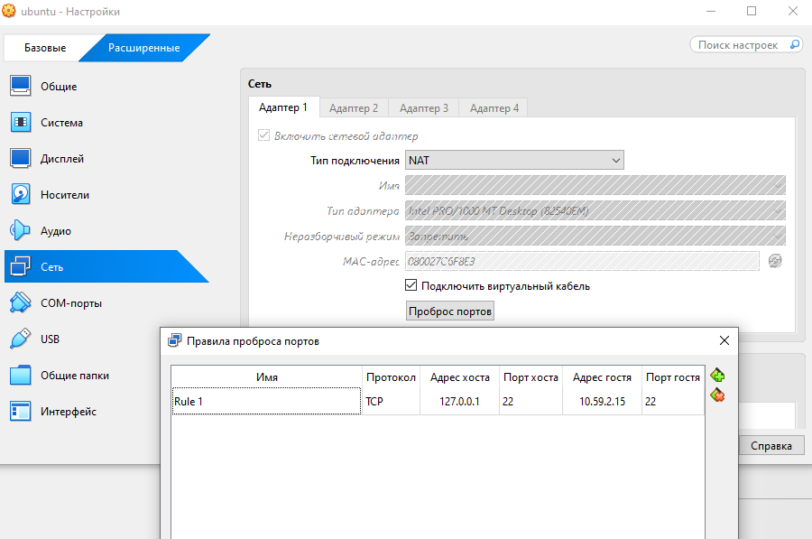

## 2. Проверка связи с внешним миром
Убедились, что ВМ имеет доступ в сеть.
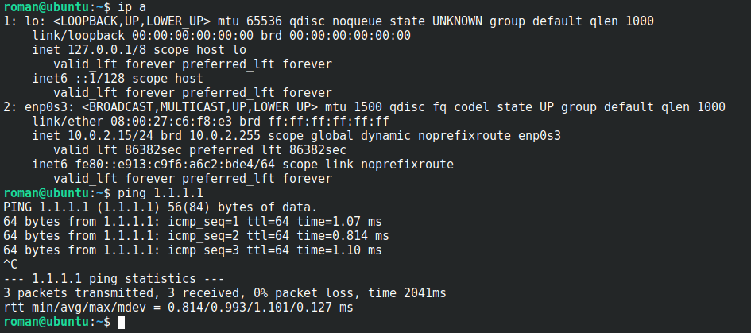

## 3. Проверка работы SSH
SSH-сервер установлен и активен в системе.
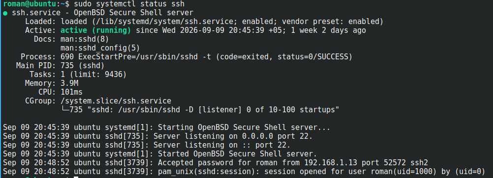

## 4. Проверка правил проброса портов
Убедились, что правило проброса настроено корректно.
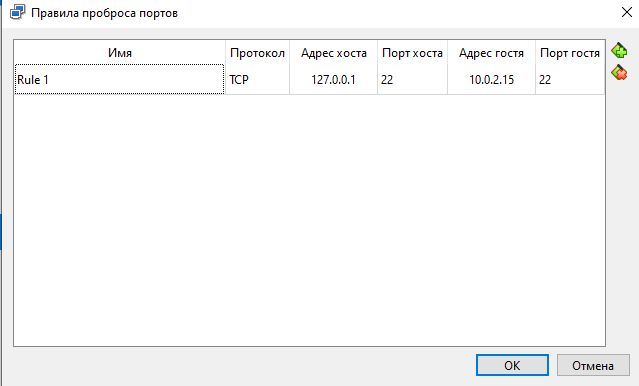

## 5. Вход по SSH через пароль
Выполнили подключение к ВМ по логину и паролю пользователя.
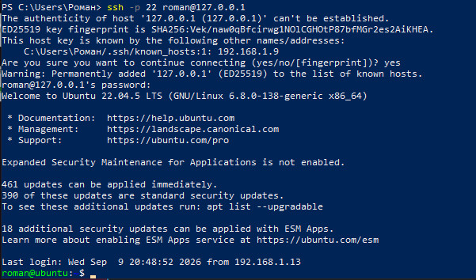

## 6. Добавление нового пользователя
Создали нового пользователя в системе.
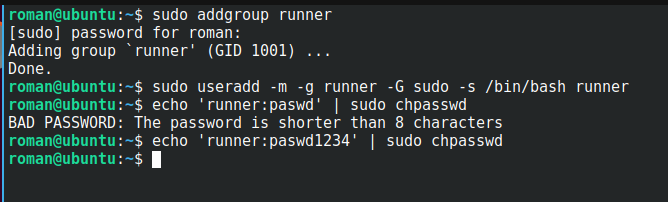

## 7. Генерация SSH-ключа на основной машине
Сгенерировали пару ключей (приватный и публичный) на хосте.
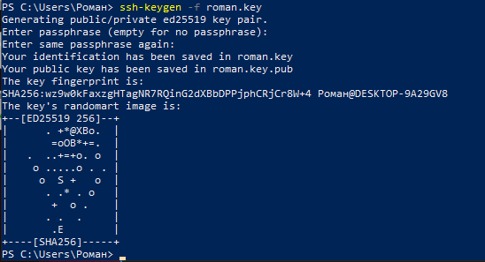

## 8. Копирование публичного ключа на ВМ
Отправили публичный ключ в `~/.ssh/authorized_keys` и проверили его наличие.
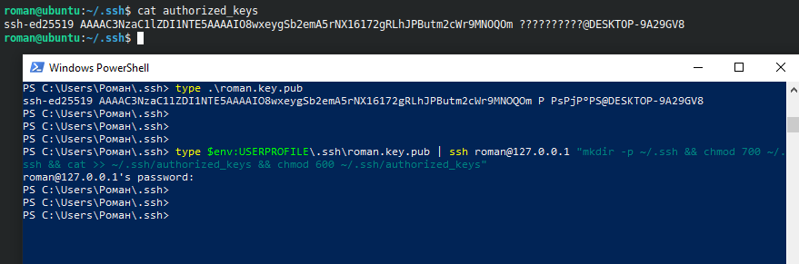

## 9. Подключение по ключу
Успешно вошли на ВМ без ввода пароля, используя ключ.
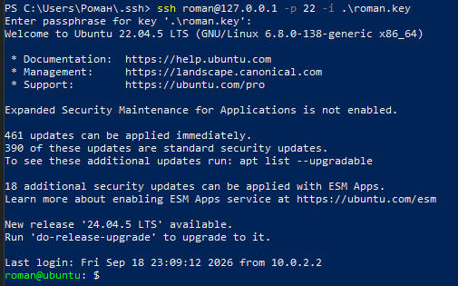

## 10. Разрешение sudo без пароля
Настроили для пользователя возможность выполнять команды `sudo` без ввода пароля.
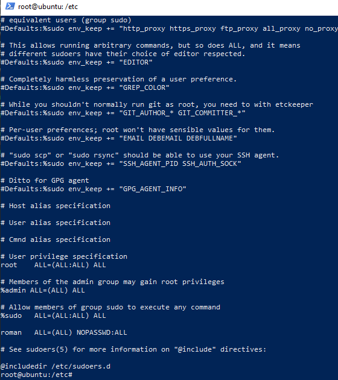

## 11. Проверка sudo без пароля
Убедились, что команды `sudo` выполняются без запроса пароля.
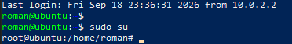

## 12. Подключение через VS Code
Настроили подключение к ВМ через расширение Remote-SSH в VS Code.
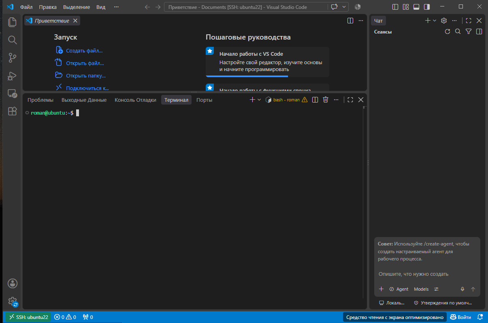

